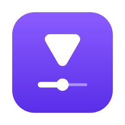

<p align="center">
  
</p>

<h1 align="center">Sweevi</h1>

App macOS bem simples (SwiftUI) para baixar vídeos com o [yt-dlp](https://github.com/yt-dlp/yt-dlp) de qualquer [site suportado](https://github.com/yt-dlp/yt-dlp/blob/master/supportedsites.md) e músicas do Spotify com o [spotDL](https://github.com/spotDL/spotify-downloader).

## Como usar

No topo, escolha **Vídeo** ou **Música** e **Um link** ou **Em massa**.

- **Vídeo · Um link:** cole o link, clique em **Buscar** e escolha uma opção (melhor qualidade, uma resolução, somente áudio em MP3 ou qualquer formato bruto).
- **Vídeo · Em massa:** cole vários links, um por linha, escolha a qualidade máxima e clique em **Baixar**. Os vídeos são baixados um de cada vez.
- **Música:** cole um link do Spotify (faixa, álbum ou playlist) ou escreva "Artista - Música", escolha o formato (MP3, M4A, FLAC, OPUS, OGG, WAV) e a qualidade. No modo em massa, cada link é baixado separadamente, com uma pausa entre eles, porque o spotDL falha quando recebe muitos links de uma vez.

A fila mostra o andamento de cada link, com botões para cancelar, tentar de novo e mostrar no Finder. Os arquivos vão para a pasta escolhida (padrão: Downloads).

## Requisitos

- macOS 12 (Monterey) ou mais recente, em Mac Intel ou Apple Silicon
- [Homebrew](https://brew.sh)

O Sweevi usa três ferramentas gratuitas: **yt-dlp** e **ffmpeg** (instalados pelo Homebrew) e **spotdl** (instalado pelo pipx). Se faltar alguma, o app mostra um botão para instalar, com barra de progresso e o console em **Detalhes**. Se o Homebrew não estiver instalado, o app abre o instalador oficial no Terminal.

Uma vez por dia o app procura atualizações dessas ferramentas e, se houver, mostra um aviso com o botão **Atualizar**. Em **Configurações → Dependências** (ícone de engrenagem ou ⌘,) ficam as versões instaladas e a verificação manual.

Para instalar tudo manualmente:

```bash
brew install yt-dlp ffmpeg pipx
```

```bash
pipx install spotdl
```

## Cookies e tokens

Para vídeos que exigem login (privados, com restrição de idade, Instagram, X…), abra **Configurações → Cookies e tokens**:

- **Importar cookies:** arraste o `cookies.txt` exportado do navegador (formato Netscape ou JSON). O app mostra, por serviço, os tokens de login encontrados e até quando valem, e entrega os cookies ao yt-dlp (`--cookies`) e ao spotdl (`--cookie-file`, para o YouTube Music). Dá para ligar ou desligar o uso em cada ferramenta.
- **Adicionar token manualmente:** cole só o valor de um cookie de login (por exemplo o `sessionid` do Instagram).
- **Spotify (spotdl):** Client ID e Client Secret do seu próprio app no [Spotify for Developers](https://developer.spotify.com/dashboard), para não depender da chave compartilhada do spotdl, e um token de acesso opcional.
- **Lembrar neste Mac:** guarda tudo nas Chaves do macOS (Keychain). Desligado, os dados ficam só na memória e somem quando o app fecha.

A cada download, o app grava uma cópia dos cookies numa pasta temporária privada (permissão 600), passa para a ferramenta e apaga em seguida. Os cookies que o site renova durante o download são guardados de volta.

## Rodar

```bash
swift run
```

Funciona só com as Command Line Tools; o Xcode completo não é necessário.

## Gerar o .app

```bash
./build-app.sh
```

Gera `Sweevi.app` universal (Apple Silicon + Intel), já com o ícone, nesta pasta. O script compila cada arquitetura separadamente, com mínimo macOS 12, e as une com `lipo`.

As Command Line Tools atuais não trazem a versão Intel da biblioteca de compatibilidade do Swift (`libswiftCompatibility56`), exigida abaixo do macOS 13. Por isso a parte Intel é compilada sem ela (`-runtime-compatibility-version none`). O app abre normalmente no Monterey Intel, mas fica sem as correções de concorrência que essa biblioteca aplica no macOS 12.x. Com um Xcode que ainda traga essa biblioteca para Intel, basta tirar essa opção do script.

## Testes

Para ver o painel de instalação sem desinstalar nada, abra o app fingindo que uma ferramenta não existe:

```bash
SWEEVI_FAKE_MISSING=spotdl Sweevi.app/Contents/MacOS/Sweevi
```

## Logo

O símbolo é o play girado para baixo: ele vira a seta de download e cai no cursor de uma barra de progresso. Os arquivos ficam em [`Branding/`](Branding):

| Arquivo | Uso |
|---|---|
| `sweevi-symbol.svg` | Símbolo colorido (violeta `#6A3DF5`) |
| `sweevi-symbol-black.svg` / `-white.svg` | Versões em uma cor |
| `sweevi-symbol-small.svg` | Versão reforçada para tamanhos pequenos (≤ 32 px) |
| `sweevi-icon.svg` / `.png` | Ícone do app |
| `AppIcon.icns` | Ícone usado pelo `build-app.sh` |
